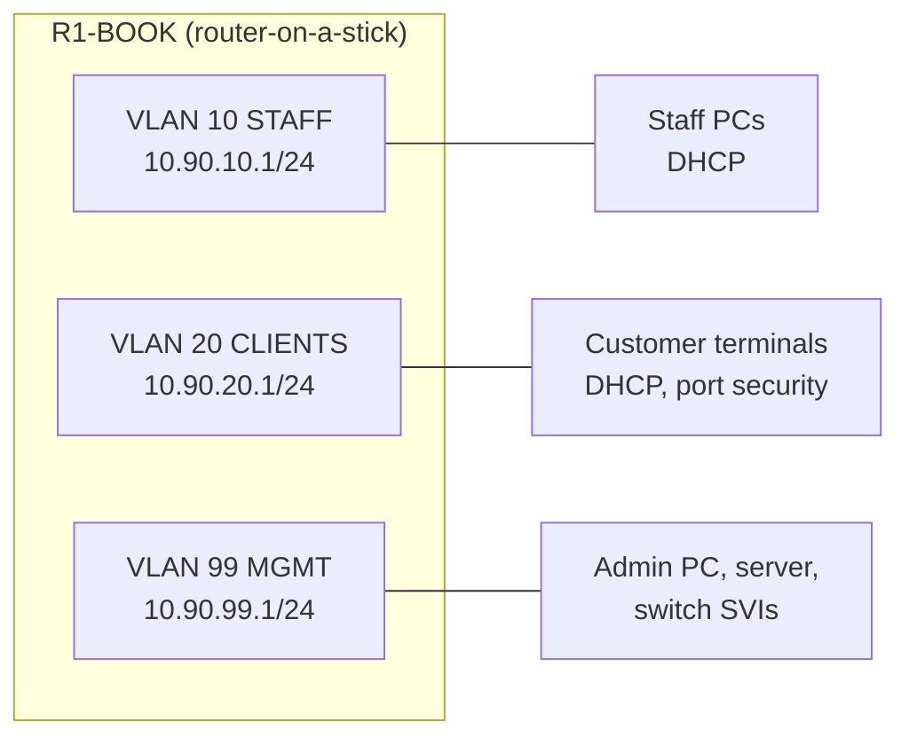

# Lab 01 – BookNook – High-Level Design

## 1. Purpose

Network for a small bookstore with three groups of users: staff, customers using in-store terminals, and IT administration. The network must separate these groups, provide addressing automatically, host an internal web page and keep network devices manageable only from the administration segment.

The original task sheet is not part of this repository; requirements below were reconstructed from the implemented configuration.

## 2. Requirements

| ID | Requirement |
|---|---|
| R1 | Separate segments for staff, customers and management |
| R2 | Routing between segments on a single router |
| R3 | Automatic IPv4 addressing for staff and customer devices |
| R4 | Internal web page available by name (`intranet.booknook.local`) |
| R5 | Device management only over SSH and only from the management segment |
| R6 | Protection of access ports against rogue switches and unknown devices |
| R7 | IPv6 addressing on the gateways (dual-stack readiness) |

## 3. Logical design

| Segment | VLAN | IPv4 | IPv6 | Addressing |
|---|---:|---|---|---|
| STAFF | 10 | 10.90.10.0/24 | 2001:DB8:90:10::/64 | DHCP from R1 |
| CLIENTS | 20 | 10.90.20.0/24 | 2001:DB8:90:20::/64 | DHCP from R1 |
| MGMT | 99 | 10.90.99.0/24 | 2001:DB8:90:99::/64 | static |
| PARKING | 999 | – | – | unused ports |

## 4. Key design decisions

| Decision | Reason |
|---|---|
| Router-on-a-stick on R1 | One router, low traffic between segments; one trunk is enough |
| DHCP on R1, first 10 addresses excluded | No extra server needed; low addresses reserved for gateways and static hosts |
| DNS and HTTP on one server in MGMT | Single internal service; the DNS server address is handed out by DHCP |
| SSH v2 + `access-class` on vty lines, local user `netadmin` | Encrypted management, limited to 10.90.99.0/24 |
| Unused ports shut down in VLAN 999 | A cable plugged into a free socket gives no access |
| Port security (sticky, restrict) on the customer port, BPDU Guard on edge ports | Customer terminals are physically exposed |

## 5. Known limitations and recommendations

- **Native VLAN:** the native VLAN on trunks is VLAN 99, which is also the management VLAN. The recommended setup is a dedicated, unused native VLAN to reduce VLAN hopping risk.
- **No inter-VLAN filtering:** CLIENTS can reach the MGMT subnet. Devices are protected by the vty ACL, but an ACL on R1 (CLIENTS → only DNS/HTTP to the server) would enforce least privilege.
- **No central logging or time source:** there is no syslog and no NTP. Both are needed before events can be correlated.
- **IPv6 only on the gateways:** end hosts are not configured for IPv6 yet (no SLAAC/DHCPv6 design).
- **Single points of failure:** one router and one uplink. This is acceptable for a small shop.
