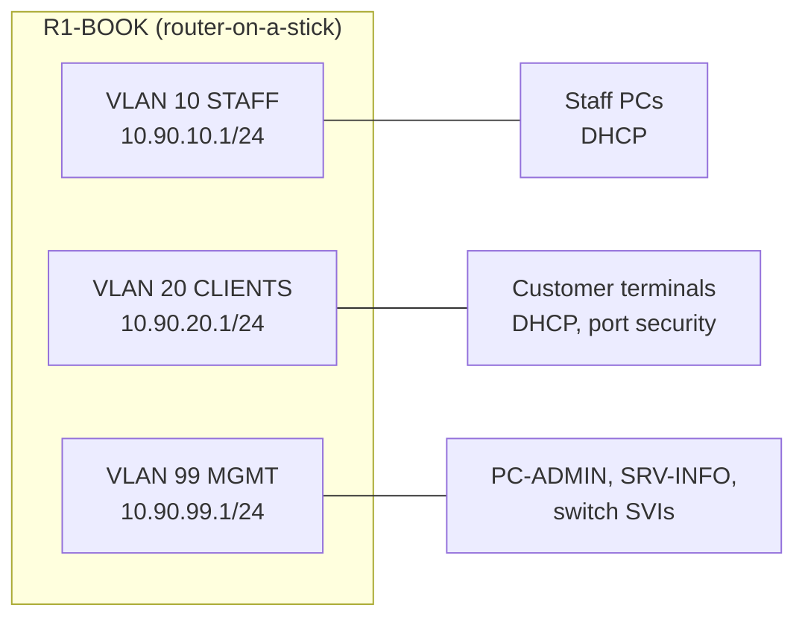

# Lab 01 – BookNook – High-Level Design

## 1. Purpose

Network for a bookstore office: staff workstations, customer terminals and an administration segment with an intranet server. The groups must be separated, addressing for users must be automatic, and network devices must be manageable only by administrators. Source: practice worksheet 8 (SkillsPoland 2026 preparation).

## 2. Requirements

| ID | Requirement (from the worksheet) |
|---|---|
| R1 | VLANs STAFF (10), CLIENTS (20), MGMT (99), PARKING (999) |
| R2 | Static 802.1Q trunks, native VLAN 99, only VLAN 10/20/99 allowed, DTP off |
| R3 | Inter-VLAN routing on R1-BOOK (router-on-a-stick), dual stack IPv4/IPv6 |
| R4 | DHCPv4 for STAFF and CLIENTS on R1, .1–.10 excluded, DNS 10.90.99.10 |
| R5 | SRV-INFO: DNS (`intranet.booknook.local`) and HTTP |
| R6 | SSHv2 only, local account with privilege 15, VTY access only from 10.90.99.0/24 |
| R7 | PortFast + BPDU Guard on host ports; port security (1 MAC, sticky, restrict) on the customer port |
| R8 | Unused ports in VLAN 999, described UNUSED, shut down |

## 3. Logical design

| Segment | VLAN | IPv4 | IPv6 | Addressing |
|---|---:|---|---|---|
| STAFF | 10 | 10.90.10.0/24 | 2001:DB8:90:10::/64 | DHCPv4, static IPv6 ::10 on PC |
| CLIENTS | 20 | 10.90.20.0/24 | 2001:DB8:90:20::/64 | DHCPv4, static IPv6 ::10 on PC |
| MGMT | 99 | 10.90.99.0/24 | 2001:DB8:90:99::/64 | static: S1 .2, S2 .3, SRV-INFO .10, PC-ADMIN .50 |
| PARKING | 999 | – | – | unused ports |

## 4. Design decisions

| Decision | Reason |
|---|---|
| Router-on-a-stick | One small office and one router. A single trunk is enough, and every inter-VLAN flow passes the router. |
| DHCP on R1 instead of the server | R1 is already the gateway of both user VLANs, so no relay is needed. |
| DNS and HTTP on one server in MGMT | Single internal service. Its address goes to clients through DHCP. |
| VTY ACL + `transport input ssh` | Management only from the admin segment and only encrypted. |
| Port security only on the customer port | Customer terminals are physically accessible to the public. |

## 5. Limitations and recommendations

- **Native VLAN:** the worksheet sets VLAN 99 as native, and VLAN 99 is also the management VLAN. In production a dedicated unused native VLAN reduces VLAN-hopping risk.
- **No ACL between CLIENTS and MGMT:** the worksheet does not require one. Devices are protected by the VTY ACL, and an inter-VLAN ACL would add least-privilege filtering.
- **No central logging or NTP:** these are outside the scope of this worksheet.
