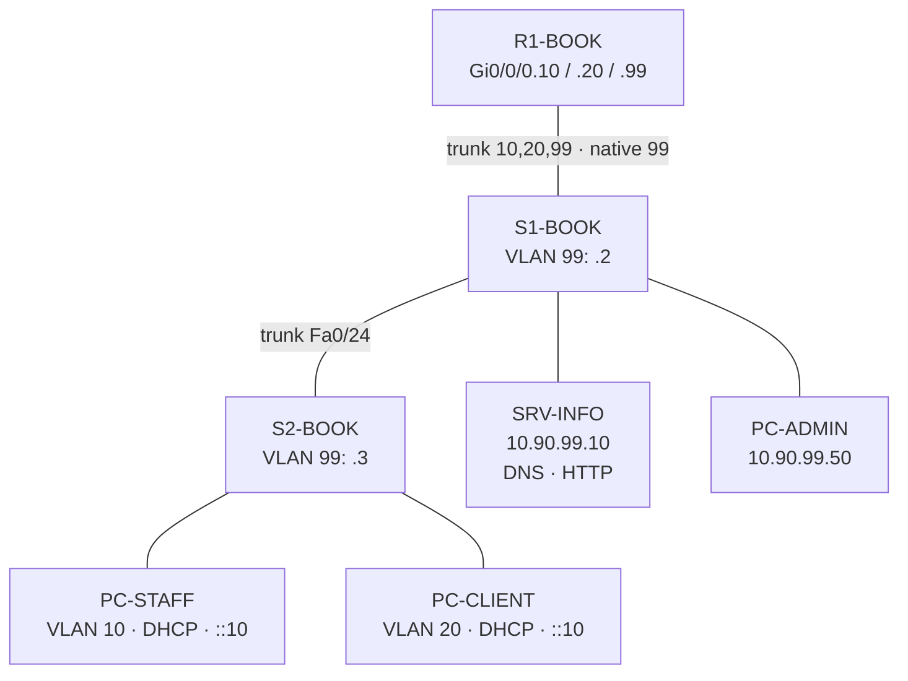

# Lab 01 – BookNook: VLANs, router-on-a-stick, DHCP, SSH

Practice worksheet 8 ("BookNook") from my preparation for the SkillsPoland 2026 national final, Skill 39 IT Network Systems Administration. The worksheet specifies a 120-minute limit, 100 points, Packet Tracer, and documentation consisting of an HLD, an LLD and a test protocol.

A small bookstore office has three segments: STAFF, CLIENTS (customer terminals) and MGMT. R1-BOOK routes between them (router-on-a-stick) and hands out IPv4 addresses with DHCP. SRV-INFO provides DNS and an intranet web page.

| | |
|---|---|
| Devices | R1-BOOK (ISR4331), S1-BOOK and S2-BOOK (2960-24TT), SRV-INFO, PC-STAFF, PC-CLIENT, PC-ADMIN |
| Topics | 802.1Q trunks (native 99, DTP off), router-on-a-stick, dual stack, DHCPv4, DNS/HTTP, SSHv2 with VTY ACL, port security, PortFast/BPDU Guard, parking VLAN |
| Files | [`lab01-booknook.pkt`](lab01-booknook.pkt) (Packet Tracer 9.0) · [`configs/`](configs) · [HLD](HLD.md) · [LLD](LLD.md) |

## Worksheet tasks (summary)

1. Hostnames, MOTD banner, descriptions on active interfaces.
2. VLANs 10 STAFF, 20 CLIENTS, 99 MGMT and 999 PARKING, with access ports assigned according to the cabling table.
3. Static 802.1Q trunks with native VLAN 99, allowed VLANs 10, 20 and 99, and DTP off.
4. Subinterfaces on R1 with IPv4 and IPv6 (`ipv6 unicast-routing`); static IPv6 `::10` on PC-STAFF and PC-CLIENT.
5. Switch SVIs in VLAN 99 (S1 .2, S2 .3) and a default gateway.
6. DHCPv4 on R1 for VLAN 10 and 20: exclude .1–.10, set the gateway and DNS 10.90.99.10.
7. SRV-INFO: static address, HTTP, A record `intranet.booknook.local`. PC-ADMIN gets a static .50.
8. SSHv2 on R1/S1/S2: domain `booknook.local`, RSA ≥ 1024, `netadmin` privilege 15, `enable secret`, Telnet blocked, VTY ACL allowing only 10.90.99.0/24.
9. PortFast and BPDU Guard on the PC-STAFF and PC-CLIENT ports. On PC-CLIENT also port security: 1 MAC, sticky, violation restrict.
10. Unused ports in VLAN 999, described UNUSED and shut down. Configuration saved.

## Review findings and fixes

Saved configuration compared against the worksheet:

| # | Finding | Fix |
|---|---|---|
| 1 | S2 SVI was `10.90.10.12` (STAFF subnet), so S2 was unreachable for management | `10.90.99.3/24`, as in the addressing plan |
| 2 | S1 SVI `.11` and PC-ADMIN `.69` did not match the plan (S1 `.2`, PC-ADMIN `.50`) | Changed to the planned addresses |
| 3 | DHCP pool for CLIENTS handed out DNS `10.90.20.10`, and there was a leftover empty pool `CLIENTS` | DNS `10.90.99.10`, extra pool removed |
| 4 | S1: only `line vty 1` had SSH + ACL; the other lines had `login` with no password | `line vty 0 15` with ACL, `login local`, `transport input ssh`; `ip ssh version 2` |
| 5 | `netadmin` on S1/S2 without `privilege 15` | `username netadmin privilege 15 secret …` (see LLD for how Packet Tracer displays it) |
| 6 | Banners used `l` as the delimiter (`banner motd line …`), giving garbled text | `banner motd #…#` |
| 7 | Descriptions such as `line STAFF` and `do Serwera`; unused ports on S2 not described UNUSED; R1 Gi0/0/1 unused but up | Consistent descriptions; UNUSED on all unused ports; Gi0/0/1 shut down |
| 8 | PortFast/BPDU Guard missing on S1 edge ports; no `service password-encryption` | Added |

## Test protocol (Packet Tracer 9.0, after fixes)

| ID | Test | Expected | Actual | Result |
|---|---|---|---|---|
| T1 | PC-STAFF `ipconfig /renew` | address from 10.90.10.0/24, gw .1, DNS 10.90.99.10 | 10.90.10.11, 10.90.10.1, 10.90.99.10 | PASS |
| T2 | PC-CLIENT `ipconfig /renew` | address from 10.90.20.0/24, DNS 10.90.99.10 | 10.90.20.11, DNS 10.90.99.10 | PASS |
| T3 | PC-STAFF `ping 2001:DB8:90:20::10` (IPv6 to PC-CLIENT) | replies | 2/2 | PASS |
| T4 | PC-CLIENT `ping 10.90.99.10` (inter-VLAN) | replies | replies, TTL 127 | PASS |
| T5 | PC-CLIENT `nslookup intranet.booknook.local` | 10.90.99.10 | 10.90.99.10 | PASS |
| T6 | PC-ADMIN `ping 10.90.99.3` (S2 SVI) | replies | replies | PASS |
| T7 | PC-ADMIN `ssh -l netadmin 10.90.99.2`, `show privilege` | login, level 15 | login OK, level 15 | PASS |
| T8 | **negative:** PC-STAFF `ssh -l netadmin 10.90.99.2` | refused (VTY ACL) | `Connection refused by remote host` | PASS |
| T9 | **negative:** PC-ADMIN `telnet 10.90.99.2` | refused (`transport input ssh`) | connection closed by foreign host | PASS |
| T10 | PC-ADMIN `ping 10.90.20.11` | replies | 2/2 | PASS |
| T11 | **negative:** foreign PC on S2 Fa0/2 (port security) | violation, restrict | not re-run in this revision | – |
| T12 | **negative:** switch on S2 Fa0/1 (BPDU Guard) | err-disabled | not re-run in this revision | – |

Lab credentials are for the simulation only.
