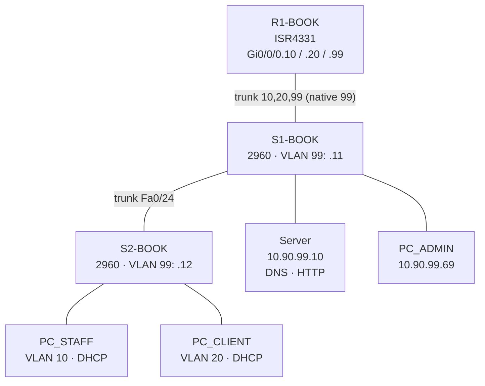

# Lab 01 – BookNook: VLANs, router-on-a-stick, DHCP

Small bookstore network: three user/management segments behind one router, an intranet server with DNS and HTTP, SSH-only device management, and dual-stack gateways.

| | |
|---|---|
| Devices | 1 × ISR4331, 2 × Catalyst 2960-24TT, 1 × server, 3 × PC |
| Topics | 802.1Q trunking, inter-VLAN routing (router-on-a-stick), DHCP server on IOS, DNS, SSH v2 with ACL on vty, port security, BPDU Guard, IPv6 addressing |
| Files | [`lab01-booknook.pkt`](lab01-booknook.pkt) (Packet Tracer 9.0) · [`configs/`](configs) · [HLD](HLD.md) · [LLD](LLD.md) |

## Review findings and fixes

The lab was reviewed after completion. Errors found in the saved configuration and the fixes applied:

| # | Finding | Impact | Fix |
|---|---|---|---|
| 1 | S2-BOOK management SVI had `10.90.10.12/24` (STAFF subnet) instead of `10.90.99.12/24` | S2 unreachable for management; SSH from PC_ADMIN failed | Address changed to `10.90.99.12/24` |
| 2 | DHCP pool `POOL_CLIENTS` handed out DNS `10.90.20.10` – no host at that address | Clients could not resolve `intranet.booknook.local` | DNS changed to `10.90.99.10`; leftover empty pool `CLIENTS` removed |
| 3 | S1-BOOK: only `line vty 1` had SSH and the access-class; lines 0 and 2–15 had `login` with no password | Inconsistent remote access policy | `line vty 0 15`: `access-class 1 in`, `login local`, `transport input ssh`; `ip ssh version 2` |
| 4 | Banners configured with `l` as the delimiter (`banner motd line ...`) | Garbled MOTD text | Rewritten with `#` delimiter; "Welcome" text replaced with an authorised-access-only notice |
| 5 | R1 Gi0/0/1 unused but administratively up; unused switch ports without `switchport mode access` | Unnecessary open ports, DTP negotiation possible | Port shut down and described; unused ports forced to access mode in VLAN 999 |
| 6 | Edge ports on S1 (admin PC, server) without PortFast/BPDU Guard | Inconsistent with S2 | PortFast and BPDU Guard enabled |
| 7 | No `service password-encryption` | Type 7 not applied to any plain-text lines | Enabled on all devices |

## Verification (Packet Tracer 9.0, after fixes)

| Test | Result |
|---|---|
| PC_CLIENT `ipconfig /renew` | 10.90.20.11/24, gateway 10.90.20.1, DNS 10.90.99.10 |
| PC_CLIENT `nslookup intranet.booknook.local` | 10.90.99.10 |
| PC_CLIENT → server `ping 10.90.99.10` | replies (inter-VLAN routing via R1) |
| PC_ADMIN → S2-BOOK `ping 10.90.99.12` | replies |
| PC_ADMIN `ssh -l netadmin 10.90.99.12` | login OK, `show ip ssh` → SSH 2.0 |
| PC_ADMIN → PC_CLIENT `ping 10.90.20.11` | replies |

Lab credentials are for the simulation only.
