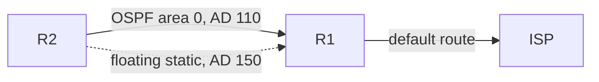

# Lab 02 – AgroTrans – High-Level Design

## 1. Purpose

A transport company has two sites: headquarters (HQ) and a warehouse (WH). The warehouse must keep access to HQ and to the internet if the primary inter-site link fails. Internet access is provided at HQ only.

The original task sheet is not part of this repository; requirements below were reconstructed from the implemented configuration.

## 2. Requirements

| ID | Requirement |
|---|---|
| R1 | Two inter-site links: primary (Ethernet) and backup (serial) |
| R2 | Dynamic routing on the primary link and automatic failover to the backup link |
| R3 | Internet access for both sites through HQ |
| R4 | Dual-stack IPv4/IPv6, including the backup path |
| R5 | Device management over SSH only, from the HQ LAN |
| R6 | Unused switch ports disabled |

## 3. Logical design

| Network | IPv4 | IPv6 |
|---|---|---|
| HQ LAN (VLAN 10) | 10.91.10.0/24 | 2001:DB8:91:10::/64 |
| WH LAN (VLAN 20) | 10.91.20.0/24 | 2001:DB8:91:20::/64 |
| LINE_A (R1–R2, Ethernet) | 10.91.0.0/30 | 2001:DB8:91:1::/64 |
| LINE_B (R1–R2, serial) | 10.91.0.4/30 | 2001:DB8:91:2::/64 |
| ISP link | 198.51.100.0/30 | 2001:DB8:91:3::/64 |
| Company aggregate | 10.91.0.0/16 | 2001:DB8:91::/48 |

### Routing

- **IPv4 between sites:** OSPF area 0 runs only on LINE_A, with `passive-interface default`. R1 originates the default route into OSPF.
- **IPv4 backup:** floating static routes with AD 150 point at the serial link. They are installed only when the OSPF routes disappear.
- **IPv6:** static routes. The primary routes use LINE_A and the backup routes use the serial link with AD 150. All of them are fully specified (exit interface + next hop) so they are withdrawn when the link goes down.
- **Internet:** PAT on R1 for 10.91.0.0/16 behind the address of the ISP-facing interface.

## 4. Key design decisions

| Decision | Reason |
|---|---|
| OSPF only on LINE_A, serial link as floating static | Clear primary/backup behaviour, no load sharing over the slow serial link |
| `passive-interface default` | OSPF hellos only where an adjacency is expected |
| PAT at HQ, no NAT at WH | Single internet exit, a single public address |
| ISP-facing interface: `no cdp enable` | No device information leaked towards the provider |
| Management limited by ACL to 10.91.10.0/24 | Administrators work from the HQ LAN |

## 5. Known limitations and recommendations

- **IPv6 routing:** IPv6 uses static routes. OSPFv3 would give the same failover with less configuration.
- **ISP link failure:** this is not detected. IP SLA with object tracking on the default route would be needed if a second ISP were added.
- **Management VLAN:** user and management traffic share the LAN VLAN at each site. A separate management VLAN is recommended.
- **Internet failover:** there is a single internet connection, at HQ. The warehouse loses internet access when HQ is down.
- **Logging:** there is no syslog/NTP.
