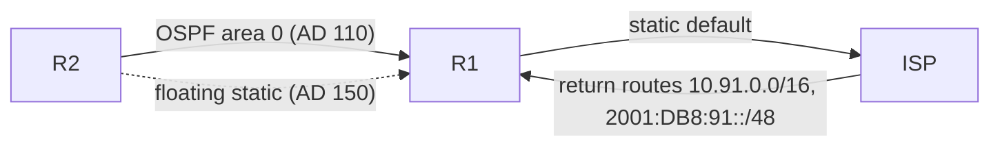

# Lab 02 – AgroTrans – High-Level Design

## 1. Purpose

A transport company with a headquarters (HQ) and a warehouse (WH). The warehouse must keep access to HQ and to the internet when the primary inter-site link fails, with no administrator action. Internet access is provided at HQ. Source: practice worksheet 9 (SkillsPoland 2026 preparation).

## 2. Requirements

| ID | Requirement (from the worksheet) |
|---|---|
| R1 | Link A (Ethernet) as primary with OSPFv2; adjacency only on link A |
| R2 | Link B (serial) as backup with floating static routes (AD 150), not in OSPF |
| R3 | Static default route on R1 towards the ISP, propagated into OSPF |
| R4 | No NAT. The ISP has return routes to 10.91.0.0/16 and 2001:DB8:91::/48 |
| R5 | Dual stack. IPv6 is routed statically. |
| R6 | SSH only, from 10.91.10.0/24, on all VTY lines; Telnet blocked; privilege-15 account |
| R7 | CDP disabled towards the ISP |

## 3. Addressing

| Network | IPv4 | IPv6 |
|---|---|---|
| HQ LAN (VLAN 10) | 10.91.10.0/24 | 2001:DB8:91:10::/64 |
| WH LAN (VLAN 20) | 10.91.20.0/24 | 2001:DB8:91:20::/64 |
| Link A | 10.91.0.0/30 | 2001:DB8:91:1::/64 |
| Link B (serial) | 10.91.0.4/30 | 2001:DB8:91:2::/64 |
| R1 – ISP | 198.51.100.0/30 | 2001:DB8:91:3::/64 |
| "Internet" (Lo0 on R3) | 8.8.8.8/32 | 2001:DB8:FF::8/128 |

## 4. Routing design

| Decision | Reason |
|---|---|
| OSPF only on link A, `passive-interface default` | Clear primary path. No hellos on LANs or towards the ISP. |
| Floating static routes over the serial link | The backup path is used only when OSPF routes disappear. There is no load sharing over the slow link. |
| Default route originated by R1 (`default-information originate`) | The warehouse learns the exit dynamically. When link A fails, its static backup default takes over. |
| Return routes on R3 instead of NAT | Required by the worksheet: the ISP routes the customer's block back to R1. |
| Fully specified IPv6 static routes (interface + next hop) | They are removed from the table when the exit interface goes down. A next-hop-only route stayed active in Packet Tracer and blocked the IPv6 backup. |

## 5. Limitations and recommendations

- **Private routing at the ISP:** a real ISP would not route RFC 1918 space to a customer. In production R1 would do PAT, as in lab 03.
- **IPv6 routing:** IPv6 is static. OSPFv3 would give the same failover with less configuration.
- **ISP link:** there is a single ISP link and its failure is not detected. IP SLA with tracking would be needed with a second provider.
- **Management VLAN:** management shares the user VLAN at each site. A separate management VLAN is recommended.
