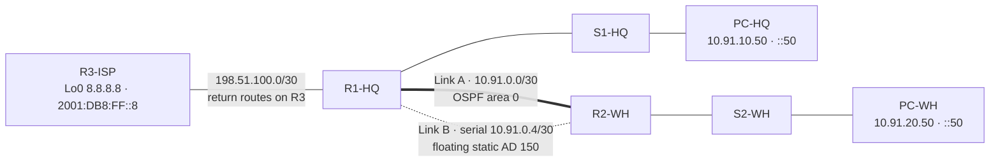

# Lab 02 – AgroTrans: OSPF, default route and backup WAN link

Practice worksheet 9 ("AgroTrans") from my SkillsPoland 2026 preparation (Skill 39). It has a 150-minute limit including documentation, and is worth 100 points.

AgroTrans has a headquarters (HQ), a warehouse (WH) and a simulated ISP. HQ and WH are joined by a primary Ethernet link running OSPF and a backup serial link with floating static routes. HQ connects to the ISP and advertises a default route to the warehouse.

| | |
|---|---|
| Devices | R1-HQ (2911), R2-WH (2901), R3-ISP (2901), S1-HQ and S2-WH (2960), PC-HQ, PC-WH |
| Topics | OSPFv2 (router-id, passive-interface default), default route propagation, floating static routes, serial link with DCE clock, static IPv6 routing, SSH with VTY ACL, CDP off towards the ISP |
| Files | [`lab02-agrotrans.pkt`](lab02-agrotrans.pkt) (Packet Tracer 9.0) · [`configs/`](configs) · [HLD](HLD.md) · [LLD](LLD.md) |

## Worksheet tasks (summary)

1. Hostnames, banner, descriptions, IPv4/IPv6 addressing, VLAN 10/20 and SVIs on the switches, `clock rate` on the DCE end (R1).
2. OSPFv2 process 1, area 0, router-id 1.1.1.1 / 2.2.2.2, `passive-interface default`, adjacency only on link A.
3. Static default route from R1 to R3, advertised into OSPF. Return routes on R3 to 10.91.0.0/16 and 2001:DB8:91::/48.
4. Floating static routes over link B (AD 150): R1 → 10.91.20.0/24, R2 → 10.91.10.0/24, and a backup default route on R2.
5. Static IPv6 routing: LANs over link A, IPv6 default route R1 → R3 and R2 → R1.
6. `enable secret`, `netadmin` privilege 15, and `service password-encryption` on R1, R2, S1 and S2.
7. SSHv2 on all four devices (`agrotrans.local`). All VTY lines allow access only from 10.91.10.0/24, and Telnet is blocked.
8. Switches: PortFast + BPDU Guard on host ports; unused ports in VLAN 999, described UNUSED and shut down.
9. CDP disabled on R1's interface to R3-ISP.
10. Failover demonstration, configuration saved, documentation.

## Review findings and fixes

| # | Finding | Fix |
|---|---|---|
| 1 | R2 had only the account `test`, and `netadmin` was missing | `netadmin` privilege 15 created, `test` removed |
| 2 | `netadmin` on S1/S2 without `privilege 15` | Added (see LLD for how Packet Tracer displays it) |
| 3 | S1: no `UNUSED` descriptions, Fa0/1 and Fa0/24 without descriptions and without `switchport mode access`, unnecessary `interface Vlan999`, typo "MENAGMENT" | Fixed; SVI 999 removed |
| 4 | R1 Gi0/0 without a description | `HQ_LAN` |
| 5 | Extension (not required by the worksheet): IPv6 had no backup over link B | Floating IPv6 routes AD 150 over the serial link |
| 6 | Problem found while testing extension 5: in Packet Tracer an IPv6 static route with only a next-hop address stays in the routing table after link A goes down, so the backup never takes over | All IPv6 static routes written as fully specified routes (exit interface + next hop) |

During this review I first added PAT on R1 and removed the ISP's return routes. Worksheet task 3 explicitly requires return routes on R3 and no NAT, so that change was reverted.

## Test protocol (Packet Tracer 9.0, after fixes)

| ID | Test | Expected | Actual | Result |
|---|---|---|---|---|
| T1 | PC-WH `ping 10.91.10.50` | replies | replies, TTL 126 | PASS |
| T2 | PC-WH `ping 2001:DB8:91:10::50` | replies | 2/2 | PASS |
| T3 | PC-WH `ping 8.8.8.8` (no NAT, return route on R3) | replies | replies, TTL 253 | PASS |
| T4 | PC-WH `ping 2001:DB8:FF::8` | replies | 2/2 | PASS |
| T5 | R1 `show ip route 10.91.20.0` | OSPF, AD 110, via 10.91.0.2 | `ospf 1, distance 110` via 10.91.0.2 on Gi0/1 | PASS |
| T6 | R1 Gi0/1 `shutdown`, R1 `show ip route 10.91.20.0` | static AD 150 via 10.91.0.6 | `static, distance 150` via 10.91.0.6 | PASS |
| T7 | Link A down: R1 `ping 10.91.20.50` | replies over link B | 5/5 | PASS |
| T8 | Link A down: R2 `ping 2001:DB8:91:10::1` | replies over link B | 5/5 (0/5 before fix 6) | PASS |
| T9 | Link A restored | OSPF route returns | adjacency FULL, AD 110 via 10.91.0.2 | PASS |
| T10 | PC-HQ `ssh -l netadmin 10.91.20.1`, `show privilege` | login, level 15 | login OK, level 15 | PASS |
| T11 | **negative:** PC-WH `ssh -l netadmin 10.91.10.1` | refused (VTY ACL) | `Connection refused by remote host` | PASS |
| T12 | **negative:** PC-HQ `telnet 10.91.10.1` | refused | connection closed by foreign host | PASS |

Lab credentials are for the simulation only.
