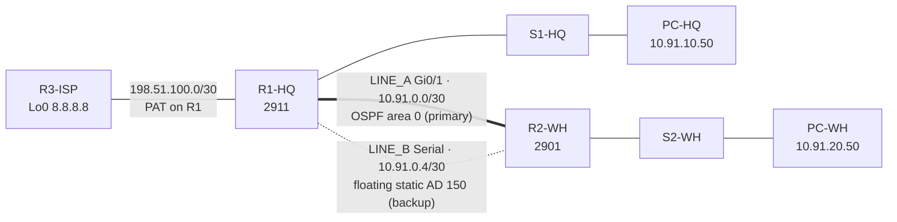

# Lab 02 – AgroTrans: two sites, OSPF, WAN failover, NAT

Headquarters and warehouse connected by two WAN links: Ethernet (primary, OSPF) and serial (backup, floating static routes). Internet access goes through the HQ router with PAT. The network is dual-stack, and the IPv6 failover was tested as well.

| | |
|---|---|
| Devices | 1 × ISR 2911, 2 × ISR 2901, 2 × Catalyst 2960, 2 × PC |
| Topics | OSPFv2 (passive-interface default, default-information originate), floating static routes (IPv4 and IPv6), fully specified IPv6 static routes, PAT, serial link, SSH with ACL |
| Files | [`lab02-agrotrans.pkt`](lab02-agrotrans.pkt) (Packet Tracer 9.0) · [`configs/`](configs) · [HLD](HLD.md) · [LLD](LLD.md) |

## Review findings and fixes

| # | Finding | Impact | Fix |
|---|---|---|---|
| 1 | No NAT on R1-HQ; the ISP router had a static route to the customer's private range 10.91.0.0/16 | Unrealistic: an ISP does not route RFC 1918 addresses | PAT (`ip nat inside source list NAT_INSIDE interface Gi0/2 overload`); ISP route to 10.91.0.0/16 removed |
| 2 | IPv6 had no backup path, so static routes existed only via LINE_A | IPv6 lost when LINE_A fails, while IPv4 failed over | Floating IPv6 static routes via the serial link (AD 150) on R1 and R2 |
| 3 | IPv6 static routes used only a next-hop address | In testing the primary route stayed in the table after LINE_A went down, so the backup never took over | All IPv6 static routes rewritten as fully specified routes (exit interface + next hop) |
| 4 | R2-WH had user `test` instead of `netadmin` | SSH with the standard admin account failed on R2 | `username netadmin` created, `test` removed |
| 5 | S1-HQ Fa0/1 and Fa0/24 without `switchport mode access`; leftover `interface Vlan999` SVI | DTP negotiation on edge ports; unnecessary SVI | Access mode forced, descriptions added, SVI removed |

## Verification (Packet Tracer 9.0, after fixes)

| Test | Result |
|---|---|
| PC-WH → PC-HQ `ping 10.91.10.50` | replies |
| PC-WH → internet `ping 8.8.8.8` | replies. ISP has no route to 10.91.0.0/16, so this proves PAT works |
| LINE_A down (`shutdown` on R1 Gi0/1): R1 `show ip route 10.91.20.0` | static, AD 150, via 10.91.0.6 (serial) |
| LINE_A down: R1 `ping 10.91.20.50` | 5/5 |
| LINE_A down: R2 `ping 2001:DB8:91:10::1` | 5/5 via serial (failed 0/5 before fix 3) |
| LINE_A restored | OSPF adjacency FULL, route back to OSPF (AD 110) via 10.91.0.2 |

Lab credentials are for the simulation only.
