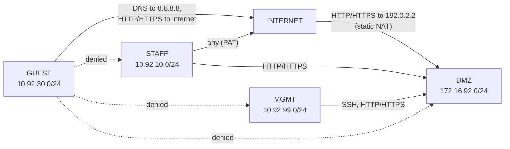

# Lab 03 – QuickBite – High-Level Design

## 1. Purpose

A restaurant needs internet access for staff and guests, a public web page hosted on its own server, and strict separation between guests, staff, management and the server. The public server must sit in a DMZ so that a compromise does not give direct access to the LAN.

Source: practice worksheet 10 (SkillsPoland 2026 preparation). The worksheet asks the HLD to justify two decisions, which are covered in section 4.

## 2. Requirements

| ID | Requirement |
|---|---|
| R1 | Separate VLANs for staff, guests and management |
| R2 | Internet access for staff and guests through one public address (PAT) |
| R3 | Web server in a DMZ, reachable from the internet on HTTP/HTTPS only |
| R4 | Guests: internet web traffic and DNS only, no access to internal networks or the DMZ |
| R5 | DMZ server management (SSH) only from the management VLAN |
| R6 | Network device management only over SSH from the management VLAN |
| R7 | Automatic addressing for staff and guests |

## 3. Security zones

| From \ To | Internet | STAFF | MGMT | DMZ |
|---|---|---|---|---|
| STAFF | yes (PAT) | – | yes (routed, no filter) | HTTP/HTTPS |
| GUEST | HTTP/HTTPS + DNS to 8.8.8.8 | no | no | no |
| MGMT | no (not in NAT ACL) | yes | – | HTTP/HTTPS, SSH |
| Internet | – | no (PAT only) | no | HTTP/HTTPS via 192.0.2.2 |

## 4. Key design decisions

| Decision | Reason |
|---|---|
| **`DMZ-OUT` outbound on Gi0/2 (the DMZ interface)** | Traffic from every zone enters the DMZ through this one interface, in the "out" direction: internet traffic after static PAT has translated the destination to 172.16.92.10, LAN traffic and management traffic alike. One ACL there filters all of it. Placed inbound on Gi0/1 it would see only internet traffic, and before translation it would have to match 192.0.2.2. |
| **R2-ISP has no routes to private networks** | R1 translates every outgoing packet to 192.0.2.2 (PAT), and incoming connections target 192.0.2.2 (static PAT). The ISP only ever sees an address from its directly connected 192.0.2.0/30, so it needs no routes to 10.92.x.x or 172.16.92.0. Such routes would also hide a broken NAT. |
| DMZ on a separate router interface, not a VLAN on the LAN switch | Physical separation of the published server |
| `ACL_GUEST` applied inbound on the guest subinterface | Guest traffic is filtered as close to the source as possible |
| Static NAT per port (80, 443) instead of a 1:1 NAT | Only the published services are exposed |
| MGMT excluded from PAT | Management stations do not browse the internet |
| Port security (sticky, restrict) on the staff port | Only the registered staff PC can use the port |

## 5. Known limitations and recommendations

- **Native VLAN:** the trunk's native VLAN is the management VLAN (99). A dedicated unused native VLAN is recommended.
- **Hairpin NAT:** this is not configured, so internal users reach the web server by its internal address 172.16.92.10. A split DNS or an internal record is needed if internal users should use the public name.
- **STAFF → MGMT:** traffic is not filtered. Devices are protected by `ACL_SSH`, but an inter-VLAN ACL would enforce least privilege.
- **Guest bandwidth:** there is no rate limiting. Policing is not available in Packet Tracer.
- **Logging and IPv6:** there is no syslog/NTP and no IPv6.
