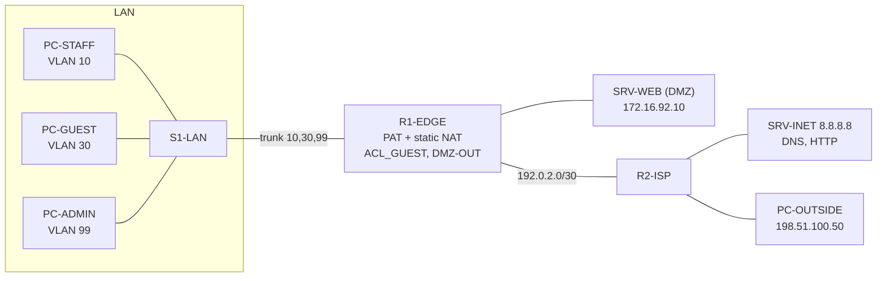

# Lab 03 – QuickBite: edge router, NAT, DMZ, ACLs

Restaurant network with staff, guest and management VLANs and a DMZ web server published to the internet. The edge router does PAT for users, static NAT (port forwarding) for the web server, and filters traffic with extended ACLs.

| | |
|---|---|
| Devices | 2 × ISR 2911, 1 × Catalyst 2960, 2 × server, 4 × PC |
| Topics | router-on-a-stick, DHCP, PAT, static NAT (port forwarding), DMZ, named extended ACLs (inbound/outbound), guest isolation, SSH with ACL, port security |
| Files | [`lab03-quickbite.pkt`](lab03-quickbite.pkt) (Packet Tracer 9.0) · [`configs/`](configs) · [HLD](HLD.md) · [LLD](LLD.md) |

## Review findings and fixes

| # | Finding | Impact | Fix |
|---|---|---|---|
| 1 | `ACL_GUEST` (inbound on the guest subinterface) had a "DHCP" remark but no permit rule for DHCP | Guests could not get an address. Before the fix PC-GUEST showed `DHCP request failed` | `permit udp any eq bootpc any eq bootps` added as the first rule |
| 2 | R1-EDGE had `ip route 192.0.2.0 255.255.255.252 192.0.0.2`: a route to a directly connected network via a non-existent next hop (typo) | Dead configuration, confusing during troubleshooting | Removed |
| 3 | ISP router left with the default hostname `Router`, a default route pointing at the customer and a route via its own address | The simulated ISP did not behave like a provider | Hostname `R2-ISP`; both routes removed. The customer is reached through the connected /30 only |
| 4 | DHCP handed out DNS 8.8.8.8, but the DNS service on SRV-INET (8.8.8.8) was disabled | No name resolution for any client | DNS enabled. A record `www.quickbite.com` → 192.0.2.2 (public address of the DMZ web server) |

## Verification (Packet Tracer 9.0, after fixes)

| Test | Result |
|---|---|
| PC-GUEST `ipconfig /renew` | 10.92.30.11/24, gateway 10.92.30.1, DNS 8.8.8.8 (before fix: `DHCP request failed`) |
| PC-GUEST `nslookup www.quickbite.com` | 192.0.2.2 |
| PC-GUEST → DMZ `ping 172.16.92.10` | `Destination host unreachable` from 10.92.30.1 (blocked by ACL_GUEST, as designed) |
| PC-OUTSIDE browser `http://192.0.2.2` | page served by SRV-WEB through static NAT |

Lab credentials are for the simulation only.
