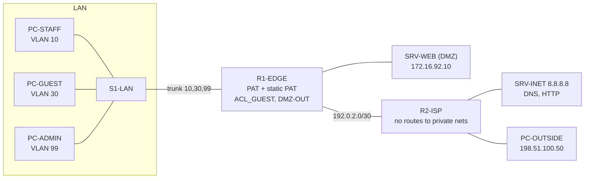

# Lab 03 – QuickBite: internet edge, NAT/PAT, DMZ and ACLs

Practice worksheet 10 ("QuickBite") from my SkillsPoland 2026 preparation (Skill 39). It has a 165-minute limit including documentation, and is worth 100 points.

QuickBite's bar network has staff, guest and management VLANs and a public web server in a DMZ. The edge router gives internet access through PAT, publishes the web server, and filters traffic with ACLs.

| | |
|---|---|
| Devices | R1-EDGE and R2-ISP (2911), S1-LAN (2960), SRV-WEB, SRV-INET, PC-STAFF, PC-GUEST, PC-ADMIN, PC-OUTSIDE |
| Topics | router-on-a-stick, DHCPv4, PAT, static PAT (port forwarding), DMZ, named extended ACLs, guest isolation, SSH with VTY ACL, port security, buffered logging |
| Files | [`lab03-quickbite.pkt`](lab03-quickbite.pkt) (Packet Tracer 9.0) · [`configs/`](configs) · [HLD](HLD.md) · [LLD](LLD.md) |

## Worksheet tasks (summary)

1. **Basics on R1 and S1:** hostnames, banner, descriptions, `enable secret`, `service password-encryption`, `netadmin` privilege 15. R2-ISP gets addressing only.
2. **S1 VLANs and trunk:** VLANs 10 STAFF, 30 GUEST, 99 MGMT and 999 PARKING. The trunk to R1 uses native 99, allows 10/30/99 and has DTP off. Add an SVI and a default gateway.
3. **R1 interfaces:** subinterfaces for 10, 30 and 99 (native), plus the WAN and DMZ addresses.
4. **Routing:** R1 has a default route to R2. R2 has no routes to private networks.
5. **DHCPv4 on R1:** for VLAN 10 and 30, with .1–.10 excluded and DNS 8.8.8.8.
6. **PAT:** overload on Gi0/1, for VLAN 10 and 30 only.
7. **Static PAT:** HTTP and HTTPS to SRV-WEB on 192.0.2.2.
8. **ACL GUEST:** extended, named, inbound. It allows DHCP, DNS to 8.8.8.8 and HTTP/HTTPS, and blocks VLAN 10, VLAN 99 and the DMZ.
9. **ACL DMZ:** from outside only TCP 80/443 to SRV-WEB, SSH only from VLAN 99, ending with `deny ip any any log`.
10. **Management:** SSHv2 on all VTY lines of R1 and S1, with access only from 10.92.99.0/24.
11. **S1 port protection:** port security on the STAFF port (1 MAC, sticky, restrict), PortFast and BPDU Guard on host ports, and unused ports in VLAN 999, described UNUSED and shut down.
12. **Logging:** `logging buffered`, with an ACL event shown in `show logging`.
13. **Wrap-up:** save the configuration and write the documentation.

## Review findings and fixes

| # | Finding | Fix |
|---|---|---|
| 1 | `ACL_GUEST` had a "DHCP" remark but no DHCP rule. Before the fix PC-GUEST showed `DHCP request failed` | `permit udp any eq bootpc any eq bootps` as the first rule |
| 2 | Leftover static routes on R1 (`192.0.2.0/30 via 192.0.0.2`) and on R2 (a route via its own address, and a default route towards the customer, which breaks task 4) | All removed; PAT and static PAT still work, which proves the ISP needs no routes to private networks |
| 3 | R2-ISP still had the default hostname `Router` | `R2-ISP` |
| 4 | `netadmin` on S1 without `privilege 15` | Added (see LLD for how Packet Tracer displays it) |
| 5 | `ip nat inside` on the physical Gi0/0 (not needed with subinterfaces); Vlan99 without a description | Removed / described |
| 6 | `logging buffered` missing from the saved R1 configuration | Added |
| 7 | DNS service on SRV-INET (8.8.8.8) disabled, although DHCP hands out 8.8.8.8 as DNS | Enabled; A record `www.quickbite.com` → 192.0.2.2 |

## Packet Tracer limitations (target IOS configuration in the LLD)

- **ACL logging:** `deny ip any any log` is rejected by Packet Tracer ("Invalid input" at `log`), so DMZ-OUT ends with `deny ip any any` and an ACL event cannot be logged.
- **`logging buffered`:** accepted (`%SYS-5-LOG_CONFIG_CHANGE: Buffer logging`), but not shown in running-config.
- **"Ping to 192.0.2.2 is blocked":** this expected result in the worksheet was an error in the sheet, already acknowledged during review. The router answers pings to its own interface address unless an inbound ACL on Gi0/1 filters ICMP.

## Test protocol (Packet Tracer 9.0, after fixes)

| ID | Test | Expected | Actual | Result |
|---|---|---|---|---|
| T1 | PC-GUEST `ipconfig /renew` | address from 10.92.30.0/24 | 10.92.30.11, gw .1, DNS 8.8.8.8 (before fix 1: `DHCP request failed`) | PASS |
| T2 | PC-STAFF `ipconfig /renew` | address from 10.92.10.0/24 | 10.92.10.11, gw .1, DNS 8.8.8.8 | PASS |
| T3 | PC-STAFF `ping 8.8.8.8` | replies (PAT) | 4/4 | PASS |
| T4 | PC-GUEST `nslookup www.quickbite.com` | 192.0.2.2 | 192.0.2.2 | PASS |
| T5 | **negative:** PC-GUEST `ping 172.16.92.10` (DMZ) | blocked by ACL_GUEST | `Destination host unreachable` from 10.92.30.1 | PASS |
| T6 | PC-OUTSIDE browser `http://192.0.2.2` | SRV-WEB page via static PAT | page displayed | PASS |
| T7 | R1 `show ip nat translations` | PAT and static entries | icmp 192.0.2.2:x ↔ 10.92.10.11:x; tcp 192.0.2.2:80/443 ↔ 172.16.92.10 | PASS |
| T8 | PC-ADMIN `ssh -l netadmin 10.92.99.1` | login | login OK | PASS |
| T9 | **negative:** PC-STAFF `ssh -l netadmin 10.92.99.1` | refused | `Connection refused by remote host` | PASS |
| T10 | **negative:** PC-ADMIN `telnet 10.92.99.1` | refused | connection closed by foreign host | PASS |
| T11 | **negative:** foreign PC on S1 Fa0/1 (port security) | violation | `PSECURE_VIOLATION` in the original run; not re-run here | – |

Lab credentials are for the simulation only.
