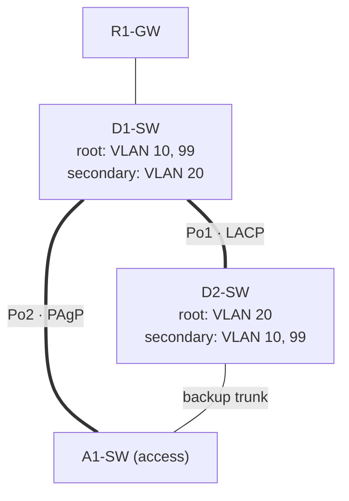

# Lab 04 – HotelNova – High-Level Design

## 1. Purpose

The HotelNova hotel is modernising its network. It is building a redundant switch block, sharing traffic between the two distribution switches, and protecting publicly accessible access ports against local attacks: a rogue DHCP server, IP spoofing, an unauthorised switch, or an unknown device on a staff port. Source: practice worksheet 12 (SkillsPoland 2026 preparation).

## 2. Requirements

| ID | Requirement (from the worksheet) |
|---|---|
| R1 | VLANs STAFF 10, GUEST 20, MGMT 99, PARKING 999. VTP transparent, VLANs created manually. |
| R2 | Router-on-a-stick on R1-GW, dual stack with SLAAC for VLAN 10/20, DHCPv4 (.1–.20 excluded) |
| R3 | EtherChannel LACP D1–D2 (Po1), PAgP D1–A1 (Po2), backup trunk A1–D2 |
| R4 | Rapid PVST+. D1 is root for VLAN 10/99 and secondary for 20. D2 is root for VLAN 20 and secondary for 10/99. |
| R5 | PortFast + BPDU Guard on host ports; port security on PC-STAFF (1 MAC, sticky, shutdown) |
| R6 | DHCP snooping on A1 for VLAN 10/20, trusted only towards distribution, 10 pps on access ports |
| R7 | IP Source Guard on the PC-GUEST port |
| R8 | SSHv2 from VLAN 99 only, privilege-15 account, `exec-timeout 5 0`, `login block-for` |

## 3. Topology

| VLAN | Path from A1 | Blocked on A1 |
|---|---|---|
| 10 STAFF | Po2 → D1 (root) | Fa0/24 |
| 20 GUEST | Fa0/24 → D2 (root) | Po2 |
| 99 MGMT | Po2 → D1 (root) | Fa0/24 |

## 4. Design decisions

| Decision | Reason |
|---|---|
| **Root bridge split between D1 and D2** | With one root for all VLANs, A1 would block the same uplink for every VLAN and that link would carry nothing until a failure. Making D1 root for 10/99 and D2 root for 20 uses both uplinks: STAFF and management go through Po2, guests through Fa0/24. Each distribution switch is secondary for the other VLANs, so a failure of either one still leaves a predictable root. |
| **Two EtherChannel protocols** | LACP (IEEE 802.3ad) is the open standard and is used in the core between D1 and D2. PAgP is Cisco-proprietary and is used towards A1, to show both negotiation modes (active/passive and desirable). Either protocol negotiates the bundle and refuses to form it when the member port settings differ, which a static `on` channel would not catch. |
| **Only ports towards distribution are trusted in DHCP snooping** | The only legitimate DHCP server, R1-GW, is reached through the uplinks (Po2 members, Fa0/24). Any DHCP OFFER/ACK arriving on an access port comes from a rogue server and is dropped. That is exactly how ROGUE-DHCP on Fa0/10 is neutralised. Trusting access ports would defeat the feature. |
| Option 82 insertion disabled (`no ip dhcp snooping information option`) | R1-GW is not a relay agent. It would drop DHCP requests carrying option 82 with a zero giaddr, and clients would stop getting addresses. |
| VTP transparent | VLANs are managed per switch, so a switch with a higher revision cannot overwrite the VLAN database. |
| DAI on VLAN 20 (extension, not required) | Uses the snooping bindings to block ARP spoofing in the public guest VLAN |

## 5. Limitations

- **Simulator limitations:** several features are not available in Packet Tracer 9.0 — DHCP snooping trust on a port-channel, IP Source Guard, and `login block-for` on the 2960. The README lists them, and the LLD gives the target IOS configuration.
- **Native VLAN:** the native VLAN is 99, which is also the management VLAN, as required by the worksheet. In production a dedicated unused native VLAN is recommended.
- **No central logging:** there is no syslog or SNMP. Snooping drops are visible only on the switch, and in a SOC they would be forwarded to a SIEM.
- **Single gateway:** R1-GW has no HSRP.
