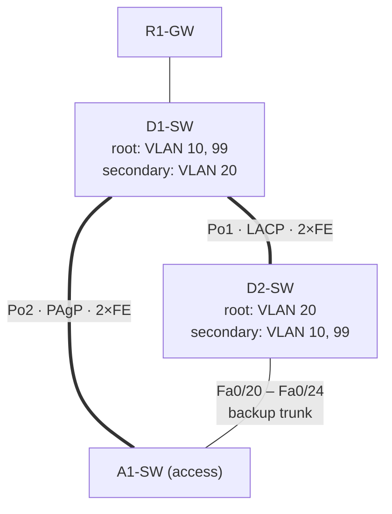

# Lab 04 – HotelNova – High-Level Design

## 1. Purpose

Hotel network for staff, guests and IT administration, built on a redundant switch block. Guest ports are publicly accessible, so the access layer must withstand typical local attacks: a rogue DHCP server, ARP spoofing, an unauthorised switch, or MAC flooding on a staff port.

The original task sheet is not part of this repository; requirements below were reconstructed from the implemented configuration and the attack scenario in the lab (a rogue router labelled "ATAKUJĄCY" connected to a guest port).

## 2. Requirements

| ID | Requirement |
|---|---|
| R1 | Separate VLANs: STAFF (10), GUEST (20), MGMT (99), unused ports in 999 |
| R2 | Redundant uplinks without loops; bandwidth aggregation between switches |
| R3 | Load sharing between distribution switches per VLAN |
| R4 | DHCP from the gateway only. A rogue DHCP server must not be able to serve clients |
| R5 | Protection against ARP spoofing in the guest VLAN |
| R6 | Only the registered staff PC on the staff port |
| R7 | SSH management from VLAN 99 only, with brute-force protection |

## 3. Topology and redundancy

- **Spanning tree:** Rapid PVST+. D1 is the root for VLAN 10 and 99, and D2 is the root for VLAN 20. Each VLAN therefore has a different preferred path from A1.
- **EtherChannel:** LACP between the distribution switches, and PAgP between D1 and A1. Both types are used in the lab to show the two protocols.
- **Inter-VLAN routing:** handled on R1-GW (router-on-a-stick), with the native VLAN set to 99.

## 4. Security controls

| Threat | Control | Where |
|---|---|---|
| Rogue DHCP server | DHCP snooping for VLAN 10 and 20; only uplinks are trusted; rate limit 10 pps on access ports | A1-SW |
| ARP spoofing / MITM | Dynamic ARP Inspection for VLAN 20, validated against the snooping bindings | A1-SW |
| Unknown device on the staff port | Port security, sticky MAC, max. 1 | A1-SW Fa0/1 |
| Rogue switch / STP manipulation | PortFast + BPDU Guard on all edge ports | A1, D1 |
| DTP-based VLAN hopping | `switchport nonegotiate` on all trunks; unused ports in VLAN 999, shutdown | all switches |
| Brute force on management | `login block-for 10 attempts 3 within 60`, `exec-timeout 5 0` | R1-GW (block-for), all devices (timeout) |
| Remote management | SSH v2 only, ACL 1 permits 10.94.99.0/24, local user | all devices |

## 5. Known limitations and recommendations

- **DHCP snooping trust on EtherChannel:** Packet Tracer does not support it. On real IOS the trust belongs on the port-channel interface. The STP cost workaround in the lab file only exists to make the simulation work (see README, finding 1).
- **Native VLAN:** VLAN 99 is the native VLAN on all trunks and also the management VLAN. A dedicated unused native VLAN is recommended.
- **DAI coverage:** it covers only VLAN 20. Extending it to VLAN 10 is recommended.
- **No central logging:** there is no syslog/SNMP, so snooping/DAI drops are visible only locally. In a SOC they should be forwarded to a SIEM.
- **Single gateway:** R1-GW has no redundancy (no HSRP).
