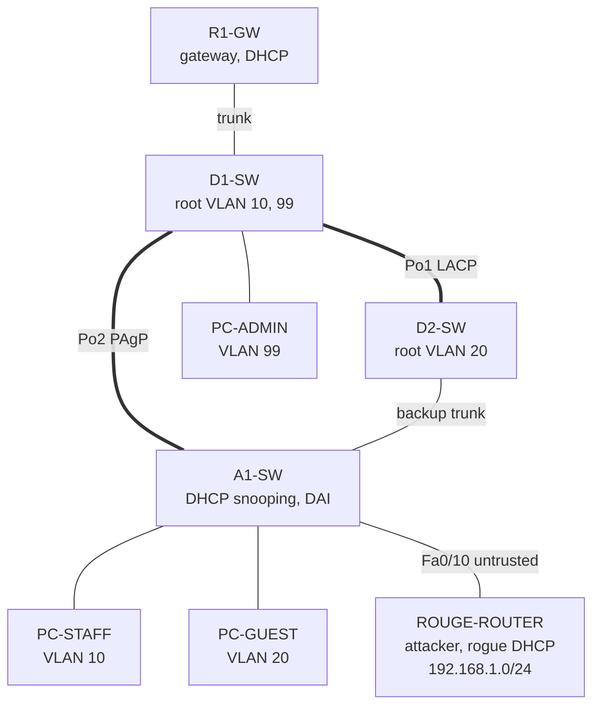

# Lab 04 – HotelNova: Layer 2 security against a rogue device

Hotel network with a redundant switch block (two distribution switches, one access switch) and a rogue router plugged into a guest port, which tries to act as a DHCP server. The lab shows how DHCP snooping, Dynamic ARP Inspection, port security and STP protection limit what an attacker can do from an access port.

| | |
|---|---|
| Devices | 2 × ISR 2911 (gateway + rogue router), 3 × Catalyst 2960, 3 × PC |
| Topics | EtherChannel (LACP and PAgP), Rapid PVST+ root placement per VLAN, DHCP snooping, DAI, port security, BPDU Guard, `login block-for`, SSH with ACL |
| Files | [`lab04-hotelnova.pkt`](lab04-hotelnova.pkt) (Packet Tracer 9.0) · [`configs/`](configs) · [HLD](HLD.md) · [LLD](LLD.md) |

## Review findings and fixes

| # | Finding | Impact | Fix |
|---|---|---|---|
| 1 | Staff PCs (VLAN 10) could not get an address. VLAN 10 used Po2 as the uplink, and in Packet Tracer 9.0 DHCP snooping drops replies arriving on a port-channel: `ip dhcp snooping trust` is rejected on `interface Port-channel2`, and the trust on member ports is not honoured | No DHCP for staff. Confirmed by testing: DHCP worked with Po2 shut down or with snooping disabled | Workaround for the simulator: `spanning-tree vlan 10 cost 100` on A1 Po2, so VLAN 10 uses the trusted Fa0/24 trunk and Po2 stays as the alternate path. On real IOS: `ip dhcp snooping trust` and `ip arp inspection trust` on `interface Port-channel2` instead |
| 2 | Trunks D1 Gi0/1 (to R1) and D2 Fa0/20 (backup trunk) still negotiated DTP | DTP left on two trunks | `switchport nonegotiate` added. DTP is now off on every trunk |
| 3 | D1 Fa0/1 (admin PC) without PortFast/BPDU Guard | Inconsistent edge-port policy | PortFast and BPDU Guard enabled |
| 4 | Typos in port descriptions (`USUSED`) | Documentation quality | Corrected to `UNUSED` |

Recommended but not applied in the lab file:
- **DAI for VLAN 10:** it is currently enabled for VLAN 20 only.
- **`login quiet-mode access-class 1` on R1-GW:** Packet Tracer rejects this command. With it, administrators could still log in from VLAN 99 while `login block-for` is active.

## Verification (Packet Tracer 9.0, after fixes)

| Test | Result |
|---|---|
| D1 `show etherchannel summary` | Po1 (LACP) SU: Fa0/23(P), Fa0/24(P) · Po2 (PAgP) SU: Fa0/21(P), Fa0/22(P) |
| PC-GUEST `ipconfig /renew` (rogue DHCP server in the same VLAN) | 10.94.20.21 from R1-GW, not 192.168.1.x from the rogue router: its offers are dropped on untrusted Fa0/10 |
| PC-GUEST `ping 10.94.20.1` | replies; DAI permits the host because it has a DHCP snooping binding |
| PC-STAFF DHCP (after fix 1) | 10.94.10.35, `ping 10.94.10.1` replies |
| A1 `show spanning-tree vlan 10` | root port Fa0/24 (cost 31), Po2 alternate |
| A1 `show port-security interface Fa0/1` | Secure-up, sticky MAC of PC-STAFF, 0 violations |

Lab credentials are for the simulation only.
