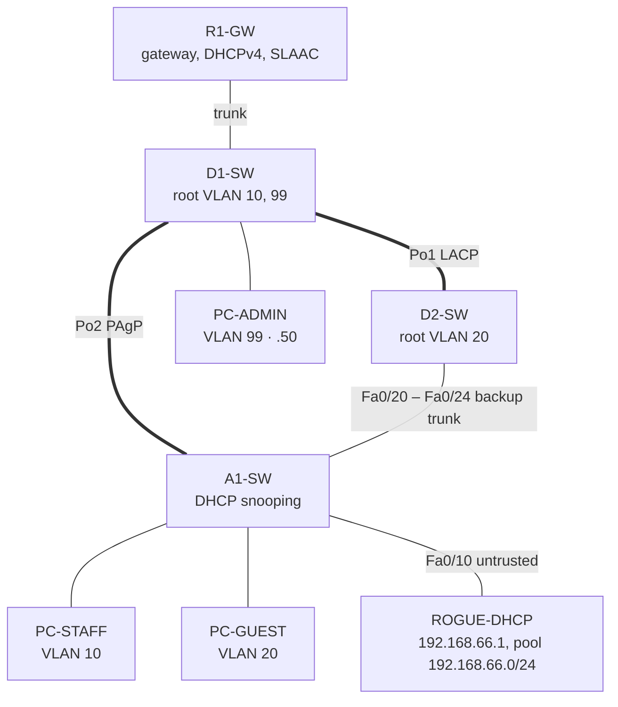

# Lab 04 – HotelNova: EtherChannel, Rapid PVST+ and Layer 2 security

Practice worksheet 12 ("HotelNova") from my SkillsPoland 2026 preparation (Skill 39). It has a 180-minute limit, the same as the final, including documentation, and is worth 100 points. Worksheet rule: if Packet Tracer does not support a feature, describe it in the LLD, give the target IOS configuration and demonstrate the rest.

The hotel network uses two distribution switches joined by EtherChannel, with an access switch connected to both. Rapid PVST+ splits traffic between the distribution switches. Access ports are protected against a rogue DHCP server and IP spoofing.

| | |
|---|---|
| Devices | R1-GW (2911), D1-SW, D2-SW, A1-SW (2960), PC-ADMIN, PC-STAFF, PC-GUEST, ROGUE-DHCP (attacker) |
| Topics | VTP transparent, router-on-a-stick with dual stack and SLAAC, DHCPv4, EtherChannel LACP + PAgP, Rapid PVST+ root per VLAN, port security, PortFast/BPDU Guard, DHCP snooping, IP Source Guard, `login block-for`, `exec-timeout` |
| Files | [`lab04-hotelnova.pkt`](lab04-hotelnova.pkt) (Packet Tracer 9.0) · [`configs/`](configs) · [HLD](HLD.md) · [LLD](LLD.md) |

## Worksheet tasks (summary)

1. **Basics on R1, D1, D2 and A1:**
   - hostnames, banner, and descriptions on all used interfaces, including port-channels;
   - `enable secret`, `service password-encryption`, `netadmin` privilege 15;
   - SSHv2 from VLAN 99 only, Telnet blocked;
   - `exec-timeout 5 0` and `login block-for`;
   - SVIs and default gateways on the switches; UNUSED ports in VLAN 999.
2. **VLANs:** VTP transparent on all switches, VLANs 10/20/99/999 created by hand, and host ports in explicit access mode.
3. **R1:** router-on-a-stick, native 99, dual stack with SLAAC for VLAN 10 and 20.
4. **DHCPv4 on R1:** for VLAN 10 and 20, with .1–.20 excluded and DNS 8.8.8.8.
5. **EtherChannel LACP D1–D2 (Po1):** a trunk with native 99, allowing 10/20/99, DTP off.
6. **EtherChannel PAgP D1–A1 (Po2), plus a single backup trunk A1–D2:** both with the same trunk parameters as Po1.
7. **Rapid PVST+:** D1 is root primary for VLAN 10 and 99 and secondary for VLAN 20. D2 is the opposite.
8. **Port protection:** PortFast and BPDU Guard on host ports, including PC-ADMIN on D1. Port security on PC-STAFF: 1 MAC, sticky, violation shutdown.
9. **DHCP snooping on A1:** for VLAN 10 and 20, trusting only Po2 and Fa0/24, with a limit of 10 pps on access ports. PC-GUEST must get its address from R1, not from ROGUE-DHCP.
10. **IP Source Guard:** on the PC-GUEST port.
11. **Wrap-up:** save the configuration and write the documentation.

## Review findings and fixes

| # | Finding | Fix |
|---|---|---|
| 1 | VTP mode not set (server by default); VLANs not visible in the configuration | `vtp mode transparent` on D1, D2 and A1. The VLAN definitions are now part of running-config. |
| 2 | `netadmin` on D1/D2/A1 without `privilege 15` | Added (see the Packet Tracer notes) |
| 3 | Rogue device built as a router named `ROUGE-ROUTER` with 192.168.1.0/24 | Renamed `ROGUE-DHCP`, 192.168.66.1/24 with pool 192.168.66.0/24 as in the worksheet; A1 Fa0/10 described ROGUE-DHCP |
| 4 | PortFast/BPDU Guard missing on the PC-ADMIN port (D1 Fa0/1) | Added |
| 5 | DTP still on D1 Gi0/1 and D2 Fa0/20 | `switchport nonegotiate` |
| 6 | Typos `USUSED` on D1; R1 Gi0/0 without a description | Fixed |

## Packet Tracer limitations (target IOS configuration in the LLD)

| Feature | Behaviour in Packet Tracer 9.0 | Effect |
|---|---|---|
| `ip dhcp snooping trust` on `interface Port-channel2` | Rejected. Trust can only be set on the member ports Fa0/21–22, and Packet Tracer does not apply it to frames arriving on the bundle. | DHCP replies for VLAN 10, which by design uses Po2, are dropped, so PC-STAFF gets no address while Po2 is up. Tested: with Po2 down (VLAN 10 over the trusted Fa0/24) PC-STAFF gets 10.94.10.23 at once. |
| IP Source Guard (`ip verify source`) | Rejected | Target configuration given in the LLD |
| `login block-for` on the 2960 | Rejected (works on R1-GW) | Brute-force protection only on the router |
| `privilege 15` in `username` on the 2960 | Accepted but not shown in running-config | `show privilege` after SSH returns 15 |

## Test protocol (Packet Tracer 9.0, after fixes)

| ID | Test | Expected | Actual | Result |
|---|---|---|---|---|
| T1 | D1 `show etherchannel summary` | Po1 (LACP) and Po2 (PAgP) SU | Po1 SU Fa0/23(P) Fa0/24(P), Po2 SU Fa0/21(P) Fa0/22(P) | PASS |
| T2 | A1 `show spanning-tree vlan 10` | root via Po2, Fa0/24 blocked | Po2 Root FWD (cost 12), Fa0/24 Altn BLK | PASS |
| T3 | A1 `show spanning-tree vlan 20` | root via Fa0/24, Po2 blocked | Fa0/24 Root FWD, Po2 Altn BLK | PASS |
| T4 | A1 `show vtp status` | transparent | `VTP Operating Mode: Transparent` | PASS |
| T5 | PC-GUEST `ipconfig /release` + `/renew` with ROGUE-DHCP active | address from R1, not 192.168.66.x | 10.94.20.21, gw 10.94.20.1 | PASS |
| T6 | PC-GUEST `ipconfig` | SLAAC IPv6 address | 2001:DB8:94:20:201:42FF:FE7B:6DB6 | PASS |
| T7 | A1 Po2 `shutdown`: PC-STAFF DHCP + `ping 10.94.10.1` | traffic via D2 | 10.94.10.23, 3/3 replies | PASS |
| T8 | A1 Po2 `no shutdown` | VLAN 10 back on Po2 | Po2 Root FWD, Fa0/24 Altn BLK | PASS |
| T9 | A1 `show ip dhcp snooping binding` | client bindings | PC-STAFF 10.94.10.23 (VLAN 10, Fa0/1), PC-GUEST 10.94.20.21 (VLAN 20, Fa0/2) | PASS |
| T10 | PC-ADMIN `ssh -l netadmin 10.94.99.4`, `show privilege` | login, level 15 | login OK, level 15 | PASS |
| T11 | **negative:** PC-STAFF `ssh -l netadmin 10.94.99.1` | refused | `Connection refused by remote host` | PASS |
| T12 | **negative:** PC-ADMIN `telnet 10.94.99.2` | refused | connection closed by foreign host | PASS |
| T13 | **negative:** foreign PC on A1 Fa0/1 | err-disabled; restore with `shutdown` / `no shutdown` | not executed in this revision | – |
| T14 | **negative:** static IP outside the bindings on PC-GUEST (IPSG) | traffic blocked | not testable – IPSG not supported in Packet Tracer | – |

Lab credentials are for the simulation only.
